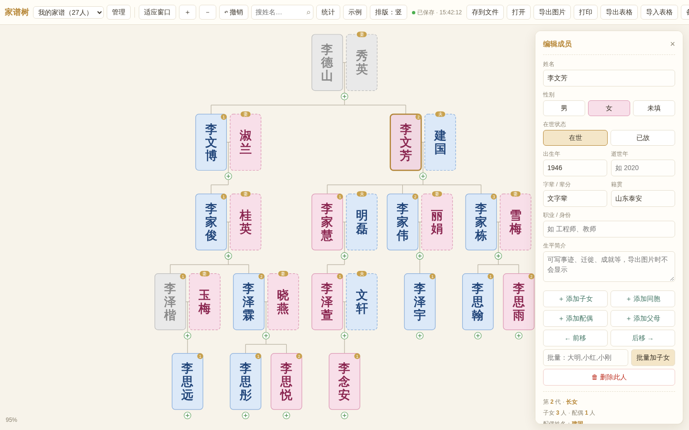

# 家谱树 · Jiapu

一个轻量、零依赖的在线家谱平台。竖排姓名卡片、可视化家族树、在线编辑，支持 **Docker（Alpine + SQLite3）** 和 **Cloudflare Workers + KV** 两种部署方式。



- 🪶 **轻量**：后端只用 Python 标准库，前端是单个 HTML 文件，无任何第三方依赖；Docker 镜像约 50MB，运行内存约 20MB
- ☁️ **免服务器**：也可以一个 `worker.js` 部署到 Cloudflare Workers，免费额度足够个人或家族使用
- 📱 **全平台**：电脑和手机浏览器都能用，手机上支持双指缩放，编辑面板变成底部抽屉

---

## 功能

**家族树展示**
- 竖排姓名卡片：男蓝、女粉、已故灰，配偶虚线框
- 排行角标（1、2、3…）和“夫 / 妻”标签
- 拖动平移、滚轮或双指缩放、一键适应窗口
- 按姓名搜索，回车跳到下一个结果
- 竖排 / 横排两种排版（横排显示生卒年）

**成员编辑**
- 姓名、性别、在世 / 已故、出生年、逝世年、字辈、籍贯、职业、生平简介
- 添加子女、同胞、配偶、父母；批量添加子女（如 `大明,小红,小刚`）
- 前移 / 后移调整兄弟姐妹排行
- 删除成员（连同其配偶和后代，删除前会确认）
- 自动计算：第几代、长子 / 次女、子女数、配偶、生卒
- 撤销（Ctrl+Z，最多 80 步），编辑后自动保存

**数据管理**
- 多家谱：新建、重命名、删除、切换
- 统计：总人数、代数、男女、在世 / 已故、平均寿命、各代人数、姓氏、字辈
- 存到文件 / 打开（JSON）
- 导出图片（PNG）、打印
- 导出 / 导入表格（CSV，Excel 可直接打开）
- 服务器备份、恢复、下载；清空、导入、恢复之前都会自动备份
- 内置示例家谱，一键载入体验

**权限**
- 可选密码登录（HTTP Basic 认证）
- 可选游客只读模式：任何人可浏览，编辑需登录
- 多人同时编辑时有版本冲突检测

---

## 快速开始

### 方式一：Docker（推荐自建服务器）

```bash
git clone https://github.com/<your-name>/jiapu.git
cd jiapu
docker compose up -d --build
```

打开 `http://服务器IP:8080` 即可使用。数据保存在 `./data/family.db`。

不用 compose 的话：

```bash
docker build -t jiapu .
docker run -d --name jiapu -p 8080:8080 -v $PWD/data:/data jiapu
```

### 方式二：Cloudflare Workers + KV（免服务器）

1. Cloudflare 控制台 → **Workers & Pages** → 创建 Worker → 编辑代码，粘贴 `worker/worker.js` 全部内容 → 部署
2. **存储和数据库 → KV** → 创建命名空间（如 `jiapu`）
3. Worker → **设置 → 绑定** → 添加 KV 命名空间，**变量名必须是 `FAMILY_KV`**
4. （可选）在 **设置 → 变量和机密** 中添加下方的环境变量
5. 访问 `https://<worker名>.<子域>.workers.dev`，也可绑定自己的域名

使用 Wrangler 部署：

```toml
# wrangler.toml
name = "jiapu"
main = "worker/worker.js"
compatibility_date = "2026-11-01"

[[kv_namespaces]]
binding = "FAMILY_KV"
id = "<你的 KV 命名空间 ID>"
```

```bash
npx wrangler deploy
npx wrangler secret put AUTH_PASS   # 可选：设置登录密码
```

### 方式三：直接运行（本地开发）

只需要 Python 3.8+，无需安装任何包：

```bash
DB_PATH=./data/family.db python3 server.py
```

---

## 配置

| 变量 | 默认值 | 说明 | Docker | Workers |
|---|---|---|:-:|:-:|
| `AUTH_PASS` | 空 | 设置后启用登录，留空则无需密码 | ✅ | ✅ |
| `AUTH_USER` | `admin` | 登录用户名 | ✅ | ✅ |
| `READ_PUBLIC` | `0` | 设为 `1`：游客可只读浏览，编辑需登录 | ✅ | ✅ |
| `MAX_BACKUPS` | Docker `50` / Workers `30` | 每个家谱保留的备份数 | ✅ | ✅ |
| `PORT` | `8080` | 监听端口 | ✅ | — |
| `DB_PATH` | `/data/family.db` | SQLite 数据库路径 | ✅ | — |

> ⚠️ 公网部署 Docker 版时，请放在 HTTPS 反向代理（Nginx / Caddy）后面，Basic 认证在 HTTP 下是明文传输的。Workers 自带 HTTPS。

---

## 项目结构

```
jiapu/
├── server.py            # 后端：http.server + sqlite3，约 300 行
├── static/
│   ├── index.html       # 前端：单文件，原生 JS + SVG 渲染
│   └── favicon.svg
├── worker/
│   └── worker.js        # Cloudflare Workers 单脚本版（内嵌前端）
├── Dockerfile           # 基于 alpine:3.20
├── docker-compose.yml
└── README.md
```

## 数据存储

**Docker 版（SQLite3，WAL 模式）**

| 表 | 内容 |
|---|---|
| `trees` | 家谱列表（名称、版本号、更新时间） |
| `members` | 成员（姓名、性别、生卒、字辈、籍贯、职业、生平、父/母 ID、配偶 ID、排序） |
| `backups` | 备份快照（JSON） |

备份整个数据库：复制 `./data/` 目录即可。

**Workers 版（KV）**

| 键 | 内容 |
|---|---|
| `trees` | 家谱列表 |
| `tree:<id>` | 一个家谱的全部成员 |
| `backups:<id>` | 该家谱的备份目录 |
| `backup:<备份ID>` | 备份内容 |

## 数据模型

家谱以“本家成员”为主线：

- 本家成员通过 `parent_id` 指向父亲或母亲（本家一方），形成树
- 配偶通过 `spouse_of` 挂在本家成员旁边，以虚线框显示
- 子女挂在本家成员下，同一对夫妻的子女共用一条连线
- `ord` 决定兄弟姐妹的排行

CSV 导入时可以只填 `父/母姓名` 和 `配偶of姓名`，系统会按姓名自动匹配关系。

## API

| 方法 | 路径 | 说明 |
|---|---|---|
| GET | `/api/trees` | 家谱列表 |
| POST | `/api/trees` | 新建家谱 `{name}` |
| GET | `/api/trees/{id}` | 读取家谱及全部成员 |
| PUT | `/api/trees/{id}` | 整体保存 `{version, members, backup?}`，版本不符返回 409 |
| PATCH | `/api/trees/{id}` | 重命名 `{name}` |
| DELETE | `/api/trees/{id}` | 删除家谱 |
| GET / POST | `/api/trees/{id}/backups` | 备份列表 / 立即备份 |
| POST | `/api/backups/{bid}/restore` | 恢复备份（恢复前自动备份当前内容） |
| GET | `/api/backups/{bid}/download` | 下载备份 JSON |
| DELETE | `/api/backups/{bid}` | 删除备份 |

## 已知限制

- **Workers 免费版 KV**：每天 10 万次读、1000 次写，单个值上限 25MB。前端在停止编辑 3 秒后合并保存一次，个人维护完全够用
- **KV 最终一致**：不同地区最多约 60 秒后才能看到更新，多人异地同时编辑时冲突检测只是尽力而为；需要多人强一致可改用 Cloudflare D1
- 导出图片使用浏览器自带字体，不同系统的楷体效果略有差异
- 超大家谱（上千人）导出图片时会自动降低分辨率，避免超出浏览器画布限制

## 说明

所有功能均由Hark AI生成。

## 许可证

[MIT](LICENSE)
